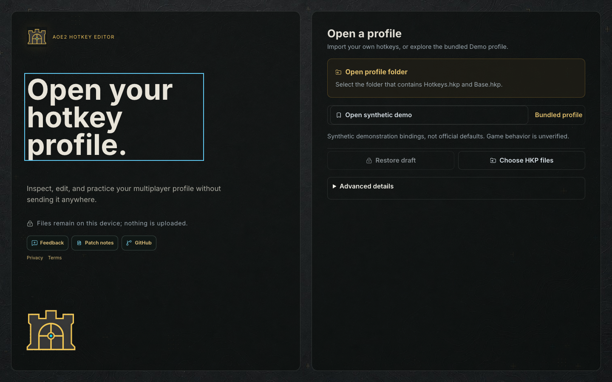
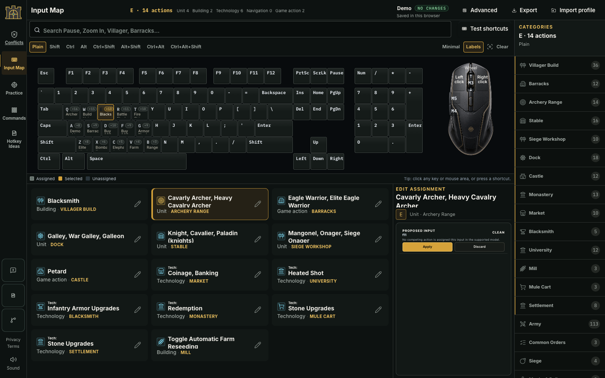
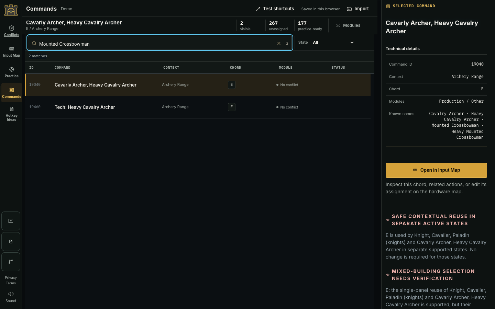

# AoE2 Hotkey Editor — synthetic demo

[Open the demo](https://meghamsh738.github.io/aoe2-hotkey-editor-demo/)

A local-first browser editor for Age of Empires II hotkey bundles. Import, inspect, edit, practice, and export without uploading a profile.

This repository contains compiled static artifacts only; the original application source and Git history remain private. Compiled JavaScript is inspectable, not a source-code secrecy guarantee.

## Try it

1. Choose **Open synthetic demo**. The example bindings are generated, not official defaults or a player's saved layout.
2. Use **Commands** to find a command, then open it in **Input Map**.
3. Preview a different input and choose **Apply**. Browser drafts survive reload; they are separate from exported game files.
4. Use **Export** and confirm the ZIP download. The ZIP can be imported again with **Choose HKP files**.

Game behavior is unverified. This site does not control the game, inject code, automate gameplay, or modify game files. Test exports manually and retain your original profile.

## Release notes — 4 October 2026

- Isolated Pages demo with neutral provenance and regenerated example bindings.
- Current unit and technology aliases retained, including Mounted Crossbowman lookup.
- Browser-only import/edit/draft/export workflow; no accounts or backend.

See [privacy](https://meghamsh738.github.io/aoe2-hotkey-editor-demo/privacy.html), [terms](https://meghamsh738.github.io/aoe2-hotkey-editor-demo/terms.html), and [third-party notices](THIRD_PARTY_NOTICES.md). Age of Empires is a Microsoft trademark; this is an unofficial editor.

## Screenshots

Actual browser captures of this compiled demo, using only the generated example profile.

